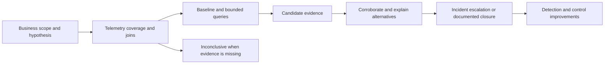

# Proactive Threat Hunting Framework

A hypothesis-driven operating framework for endpoint, identity, email, AWS, Azure, Google Cloud, Kubernetes, network, DNS, SaaS, AI, CI/CD and backup/recovery telemetry.

**Version 0.1:** 17 reusable hunt procedures and local normalized SQL queries. The laboratory includes 17 seeded candidate scenarios and 17 benign/broken-chain comparisons. Queries are tested in local SQLite, not a production SIEM. No live telemetry collection, customer hunt, response action or confirmed compromise is claimed.

| Start with | Material |
|---|---|
| Plan and conduct a hunt | [Operating model](docs/OPERATING-MODEL.md) · [Roles and delivery cadence](docs/ROLES-AND-CADENCE.md) |
| Establish observable scope | [Telemetry requirements](telemetry-matrix.csv) · [Coverage and normalization](docs/TELEMETRY-AND-COVERAGE.md) |
| Identify known indicators and newly observed behavior | [Indicator/novelty method](docs/INDICATORS-AND-BASELINES.md) |
| Execute a bounded procedure | [Hunt catalog](HUNT-CATALOG.md) · [Hunt pack](hunt-pack.json) · [SQL queries](queries) |
| Investigate and disposition | [Triage](docs/TRIAGE.md) · [Case record](templates/case-record.md) |
| Validate the reference behavior | [Lab instructions](lab/README.md) · [Evidence](evidence/README.md) |
| Adapt to a real platform | [Provider/connector mappings](docs/ADAPTER-VALIDATION.md) |
| Judge limits and provenance | [Limitations](docs/LIMITATIONS.md) · [Sources](docs/SOURCES.md) |

## Workflow

The reference engine separates `candidate_leads`, `no_lead_in_observed_data` and `inconclusive_coverage`. It does not convert a quiet or missing feed into "no compromise". "First observed" always refers to the supplied, sufficiently covered baseline, not previously unknown attackers worldwide.

[Related cloud/AI authority study](../../research/001-cloud-ai-infrastructure/README.md) · [Repository index](../../README.md).
