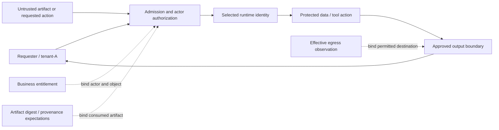

# Threat model

## Assets and actors

Assets: protected tenant documents, model and image artifacts, runtime identities, approved tool actions, training/inference outputs, entitlement records and audit evidence. Principals: tenant-A requester, workload submitter, artifact publisher, local mock runtime and tool/retrieval service identity. A protected tenant-B record is intentionally synthetic.

The attacker starts with a legitimate low-scope ability to submit a job, alter an artifact, query a retriever or supply an action request. Administrator compromise, container escape, token signature forgery and provider-control-plane compromise are outside scope. Only specifically listed preconditions are granted.

## Trust boundaries

## Attack tree for unauthorized disclosure

The root requires all of: controllable operation; an admitted/runtime authority path; effective access to a protected record; a permitted disclosure route; and a violated business entitlement. Runtime access is reached through one of the separately defined provider scenarios. Alternative paths outside these graphs remain unassessed.

| Misuse | Boundary crossed | Evidence needed |
|---|---|---|
| Submit controlled code on broader runtime | Requester to workload identity | Effective job/admission permission, permitted selected identity, trust/setup, workload control |
| Replace artifact consumed after approval | Publisher to trusted runtime | Actual consumed digest, producer permission, verification/admission behavior |
| Retrieve another tenant's record | Caller to retrieval service | Caller entitlement, object/chunk ACL, retrieval identity, downstream check and answer/export path |
| Disclose through permitted outbound route | Data plane to output/sink | Actual destination, effective network/control behavior and application output policy |
| Trigger out-of-scope tool action | Untrusted request to tool authority | Allowed action, requester authority, tool effective permission, independent approval and execution trace |

A private endpoint or an absence of direct caller data access does not itself settle the business-boundary question. Model this as an evidence requirement, not a claim about a particular organization's configuration.
