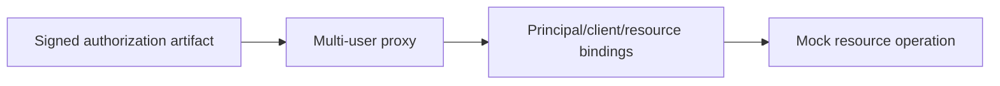

# CAI-003: Principal binding across multi-user MCP authorization flows

## A signed-artifact proxy study of principal, client, audience, and handle ownership

Ashish Srivastava · Version 0.2 · 2026-11-24 · Controlled local research report; independent review pending.

## Abstract

This study examines a specific authorization boundary using a small, executable local system. The tested proposition is: Valid signatures and expiry do not authorize a principal/client/resource mismatch; all bindings required by the declared proxy contract must hold. Three implementations are compared against the same 36 authored fixtures: a seeded permissive profile, a partial control, and a guarded profile. Across 108 condition trials, the permissive profile produced 24 forbidden effects in 24 adversarial cases; the partial profile retained 18. The guarded profile blocked all authored forbidden effects while preserving 6/6 legitimate effects. Six behavioral regression methods also passed. The evidence is a controlled mechanism demonstration, not a population benchmark. The artifact is a two-part HMAC-signed JSON fixture, not an interoperable JWT. There is no browser OAuth flow, complete MCP server, consent UI, token endpoint, PKCE test, or third-party proxy assessment. Intended delegation requires a distinct documented contract.

## 1. Problem and motivation

Security checks often exist at one point in a workflow while the protected effect occurs later or under a different authority. The relevant question is whether the declared policy remains binding at that later effect. Checking a representation or accepting a prior decision does not automatically preserve authorization across transformations, reuse, handoffs, or execution. This report investigates that distinction with explicit inputs, expected policy labels, and observable effects rather than relying on descriptive model output.

Primary guidance and prior research establish the background risk; they do not validate this local implementation. See [the annotated related-work review](RELATED-WORK.md) and [source register](SOURCES.md). The study contribution is a self-contained fixture corpus, executable control comparison, and traceable evidence for the bounded proposition. It is not a claim that the underlying attack class is new.

## 2. Research questions and hypotheses

**Original portfolio hypothesis:** A multi-user MCP proxy with incomplete binding among user, client, session, consent, and token audience can accept an authorization artifact created for a different principal or client.

**Evaluated local proposition:** Valid signatures and expiry do not authorize a principal/client/resource mismatch; all bindings required by the declared proxy contract must hold.

**Original null:** Authorization artifacts remain bound to their intended principal, client, resource, and lifecycle state.

**Operational local null:** the seeded implementation does not cross the declared boundary on any authored forbidden case, or the guarded control cannot preserve both boundary enforcement and positive-case behavior. This is a deterministic corpus check, not a statistical population null. For the cache timing extension, membership discrimination is evaluated separately and descriptively.

**Hypothesis status:** Constructed local mechanism supported; implementation-level and population claims not established. A successful constructed failure establishes that the mechanism is possible in the code provided, not that an unexamined product is affected.

## 3. System and threat model

The protected endpoint is **Execution receipt from the mock downstream resource.**. Inputs and expected labels are recorded in [the fixture corpus](lab/fixtures.json). The attacker controls only the fields defined by each fixture; the trusted policy and corrected gate are outside attacker control. No real credential, customer data, cloud account, or production service appears in the lab.

**Formal boundary:** `Accept implies ValidSignature AND IntendedIssuer AND Fresh AND SubjectMatchesCaller AND ClientMatches AND AudienceMatches AND HandleOwnerMatches.`

The formula expresses the experiment's declared policy. Its assumptions and scope are documented in [the threat model](THREAT-MODEL.md); it is not a proof about all implementations of a protocol.

## 4. Mechanism and experimental conditions

All profiles check a synthetic artifact signature, issuer, and expiry. Deliberately omitted bindings permit a resource operation even though the artifact belongs to a different user, client, resource audience, or workflow owner. Adding subject validation alone leaves other bindings unresolved.

- **vulnerable:** Signature, issuer, and expiry checks.
- **partial:** The same checks plus caller/subject binding.
- **guarded:** All declared subject, client, audience, and handle-owner bindings.

The partial profile is included to distinguish a narrow control from enforcement at the complete effect boundary. Where the partial profile has the same failure counts as the permissive profile, the experiment does not imply a statistical difference; it shows that the particular added metadata or check did not resolve the authored mismatch.

## 5. Method

The corpus contains six named scenario types in six synthetic identity contexts. Case IDs and policy labels are specified independently of the returned observation. Every fixture runs once in each condition, yielding 108 corpus trials. Reexecutions performed by the regression methods are control checks and are not counted as independent research samples.

The runner observes an actual local effect, records decision steps, exports CSV rows and JSON traces, and hashes the source inputs. Six regression methods cover legitimate effects, adversarial effects, negative controls, the seeded failure, trace presence, and fixture completeness. These tests are behavioral assertions about the declared boundary; they do not certify a production implementation.

Execution used a pinned Python 3.12.16 image on Linux/aarch64, UID 1000, a read-only root and source volume, bounded CPU/memory, dropped capabilities, no-new-privileges, and disabled external networking. Temporary results were written outside source. The SSRF lab uses actual loopback HTTP, which remains available inside the isolated container. No external attack ran. Source hashes are in [the tested-input manifest](evidence/source-manifest.json).

The design is exploratory and was not externally preregistered. Fixture proportions deliberately favor boundary coverage. Repeated nominal contexts do not establish deployment frequency or independent prevalence observations. See [methods](METHOD.md) for variable definitions and controls.

## 6. Results

| Condition | Forbidden effects / adversarial cases | Legitimate effects / positive cases | Negative-control failures | Policy matches / all cases |
|---|---|---|---|---|
| vulnerable | 24/24 | 6/6 | 0/6 | 12/36 |
| partial | 18/24 | 6/6 | 0/6 | 18/36 |
| guarded | 0/24 | 6/6 | 0/6 | 36/36 |

Counts are literal observations in this authored corpus. A forbidden effect is defined by the endpoint and fixture policy, not by a narrative claim or by the presence of an attack-like string. The guarded profile matched 36/36 expected policy labels; zero observed corpus failures is not a universal robustness guarantee.

[CSV observations](evidence/results.csv), [effect traces](evidence/traces.json), [summary](evidence/summary.json), and [regression output](evidence/tests.txt) permit row-level inspection. [The claim register](CLAIM-EVIDENCE.md) separates direct evidence from interpretation and pending hypotheses.

## 7. Discussion and engineering implications

The practical implication is conditional: if an implementation has the same unchecked transition and the same authority assumptions, enforcement at the final boundary is a candidate remedy. The local comparison makes that transition inspectable. It does not justify labeling an existing service vulnerable without verifying its actual preconditions and effects.

The guarded profile's retained positive cases show that a complete denial of all operations was not needed for this corpus. They do not demonstrate broad usability, latency, or throughput. The observed results should motivate an implementation-specific investigation with broader legitimate workflows, versioned policies, and missing-context handling. The original proposed production tool remains a design; the runnable artifact is a local prototype and test harness.

## 8. Validity and limitations

The artifact is a two-part HMAC-signed JSON fixture, not an interoperable JWT. There is no browser OAuth flow, complete MCP server, consent UI, token endpoint, PKCE test, or third-party proxy assessment. Intended delegation requires a distinct documented contract.

Additional limitations are shared across studies: the author defined both mechanisms and fixtures; no independent reproduction or blind holdout implementation was assessed; six contexts are nominal variations, not randomly sampled organizations; the workload intentionally contains known flawed configurations; and source retrieval is not an exhaustive literature search. [LIMITATIONS.md](LIMITATIONS.md) identifies which conclusions remain unsupported.

## 9. Conclusion and next validation

The executed local system provides bounded evidence for the stated mechanism and a corrected boundary under its declared policy. It neither establishes global novelty nor confirms a provider defect. Run protocol-conformant authorization cases against a scoped proxy with real resource indicators, consent lifecycle, and protocol-version requirements. The next phase must follow [the validation protocol](VALIDATION-PROTOCOL.md) and retain failed and negative results.

## References and reproducibility

[Annotated primary sources](SOURCES.md) · [Related work](RELATED-WORK.md) · [Reproduction instructions](REPRODUCIBILITY.md) · [Preparation provenance](PROVENANCE.md) · [Citation metadata](CITATION.cff).
